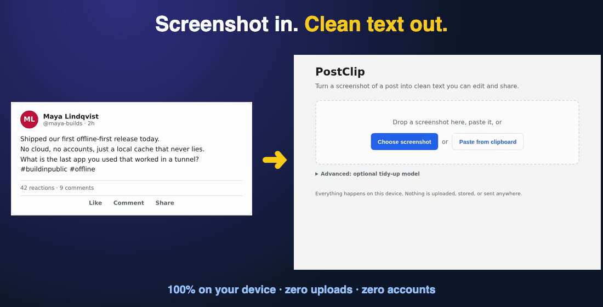

# smll 🧰✨

> Small models. Big jobs. Your laptop. 💪 A portfolio of local-first apps where a tiny open-weight model does the heavy lifting on a plain CPU, built by an AI agent that has to show its receipts before anything merges.

**No cloud model. No upload. No "trust me bro".** Each app ships its *own* small model, and that model has to beat a boring non-AI baseline in a measured fight or it doesn't ship. Every claim is backed by a test that actually ran.

## 🎯 The lineup

| Project | The pitch | The vibe check |
|---|---|---|
| 📸 [**postclip**](projects/postclip/) | You screenshot a post. It hands you the *words*. Share the image in, get clean copy-ready text out, including text hiding inside the images inside the screenshot. 🕵️<br><br>[](projects/postclip/docs/demo/postclip-full-demo.mp4) | ✅ **Built.** Offline, zero uploads, no accounts, embeddable in your app. Big **Copy** button first, because we respect your thumb. [Demo 🎬](projects/postclip/docs/demo/postclip-full-demo.mp4) · [Every flow 🎬](projects/postclip/docs/demo/postclip-demo.mp4) · [Embed it](projects/postclip/docs/INTEGRATION.md) |
| 🔒 [**coaching-privacy-pipeline**](projects/coaching-privacy-pipeline/) | Coaching sessions are packed with names, employers and "wait, I could work out who that is" clues. This scrubs them, then **audits itself** and blocks when it isn't sure. 🙈 | ✅ **Built** (`v0.1.0-poc`). Transcripts *and* audio, fully offline, nothing generative to make stuff up. Synthetic data only, and *not* a compliance stamp. [Status](projects/coaching-privacy-pipeline/docs/status.md) |

### 🚧 Up next: the small-model portfolio

Planned and queued for the agent, built one at a time in this order. Each picks its model by measurement against a non-AI baseline; if the small model loses, the baseline ships and the numbers get published anyway.

| # | Project | The pitch | What the small model is showing off |
|---|---|---|---|
| 1 | 📂 [**folderchat**](projects/folderchat/) | Ask your folders and Google Drive anything. Get answers that **quote the exact passage**, or an honest "not found". Share the answer with links. | Citing its sources word for word, and knowing when to shut up |
| 2 | 📬 [**inboxpilot**](projects/inboxpilot/) | Your inbox, triaged and summarised, with replies drafted in the sender's language. You approve everything. It **cannot send**. Like, physically. | Tool calling that doesn't fall for "ignore previous instructions" emails |
| 3 | 🧾 [**receiptledger**](projects/receiptledger/) | Receipts from email, Drive, phone photos and bank statements become a tidy, categorised ledger. GST maths checked. | Reading crumpled receipt photos better than OCR + regex |
| 4 | 🎙️ [**voicenote**](projects/voicenote/) | Rant into your phone in Hinglish, Tamil or English. Get a transcript, a summary and dated to-dos in your calendar. "Kal shaam" included. | Indian languages and code-mixed speech on a CPU |
| 5 | 📈 [**tickerpulse**](projects/tickerpulse/) | News, filings and posts for your watchlist, read by a small model and turned into an explained Buy/Hold/Sell, with an honest backtest. Paper trading only, not advice. | Reading sarcasm, slang and "$META vs meta" into structured signals |

All five are `PLAN_ONLY`: the plan, rules and plan-check scripts are in place, and no product code exists yet. The agent doesn't sleep. 😴❌

## 🤖 Wait, an agent builds these?

Yep. **Atina** reads a plan, writes a test that *fails first* (on purpose, for the right reason), makes it pass, commits the evidence and opens a PR. You type one line:

```text
 "Continue postclip."  ──►  issue ──► RED ──► GREEN ──► evidence ──► PR ──► CI ✅ ──► merged ──► proof posted
```

- **One feature = one PR = one demo.** No lonely utilities that do nothing.
- **PASS means a test ran and passed.** Not "felt right". Not "probably".
- **Stuck? It says `BLOCKED`.** It does not get creative with your repo.
- Rulebook: [`AGENTS.md`](AGENTS.md).

<details>
<summary>🛠️ Add a project / set up the repo</summary>

**New project**
1. Make `projects/<name>/` with its own `AGENTS.md`, `README.md`, `docs/BUILD_PLAN.md`, `docs/status.md` and real `scripts/{setup,test,demo,verify}.sh`.
2. Generate the work queue: `python3 tools/gen_issues.py --project <name>` (preview; add `--create --repo owner/name` to go live).
3. Tell the agent: "Continue `<name>`."

One `.git/`, at the root. Never `git init` a second repo in here.

**Owner setup (once)**
- Protect `main` with a PR-only ruleset requiring **`monorepo / verify`** (CI is in `.github/workflows/monorepo-ci.yml`).
- Install the Atina Autobot GitHub App on this repo only. Short-lived tokens, commits as `atina-autobot[bot]`.
- Optional: enable auto-merge.

**Heavy ML:** real-model gates may need an approved capable runner. They are never quietly mocked, and weights, secrets and real recordings are never committed.

</details>
