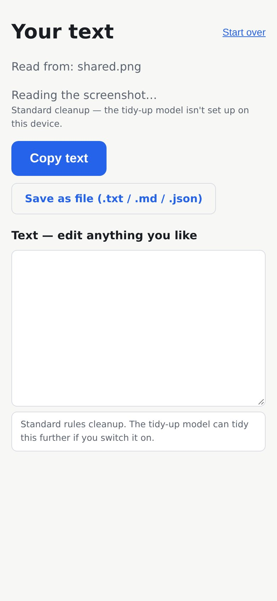
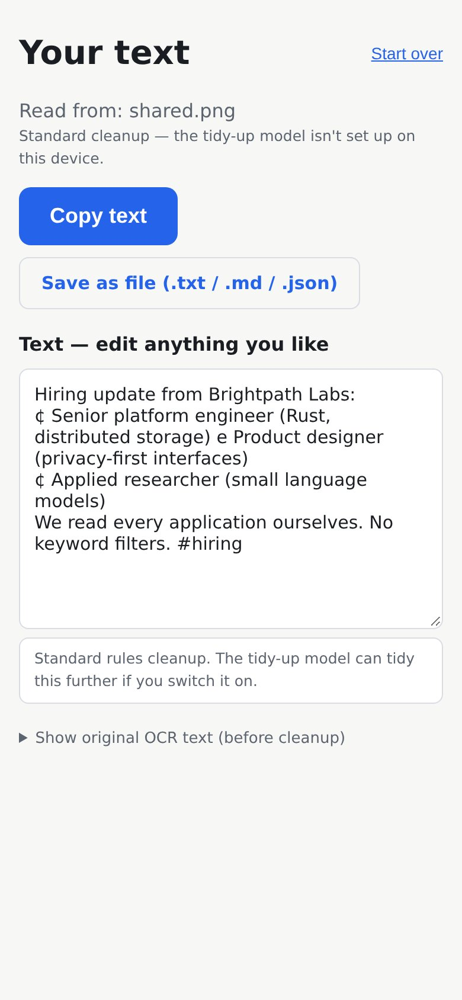
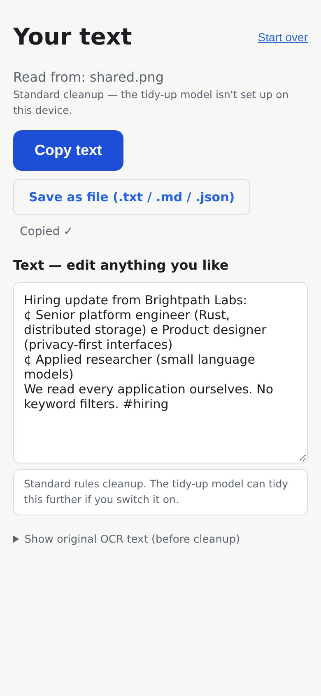
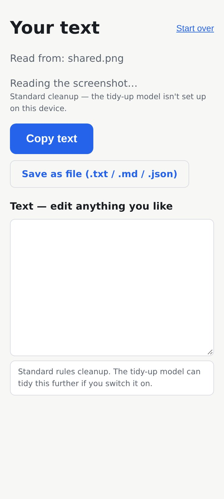
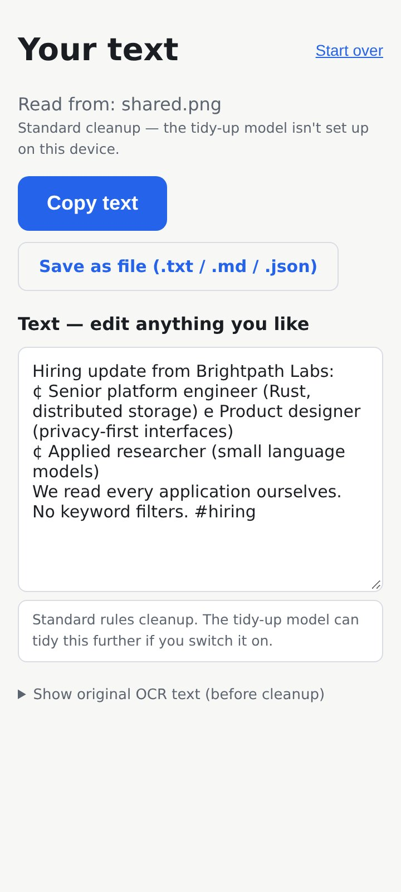

# O07 — R2-1 share-first result screen (owner gallery)

Real screenshots from a passing run of `node scripts/capture_owner_gallery_r2_1.mjs`
(test build, Chromium, the service-worker share-target POST — the same handler
Android's share sheet hits; the real installed-PWA share is the plan's A27 device pass).
No model download: the default rules-only state is what ships by default.

A shared screenshot arrives (390x844): PostClip starts reading it by itself — one clear progress state, no extra tap, no home screen on this path.

The result screen (390x844): your text with the large Copy button first — fully above the fold, unscrolled — then Share and Save-as-file, then Edit.

Copy pressed at 390×844: the text is on the clipboard and the confirmation shows right next to the button.

A shared screenshot arrives (360x800): PostClip starts reading it by itself — one clear progress state, no extra tap, no home screen on this path.

The result screen (360x800): your text with the large Copy button first — fully above the fold, unscrolled — then Share and Save-as-file, then Edit.

