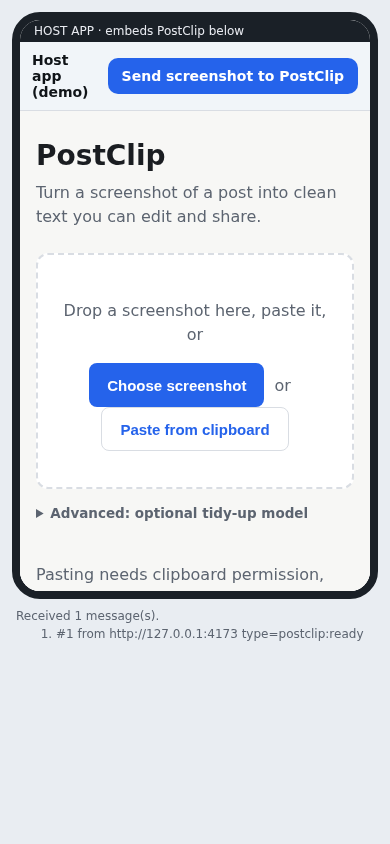
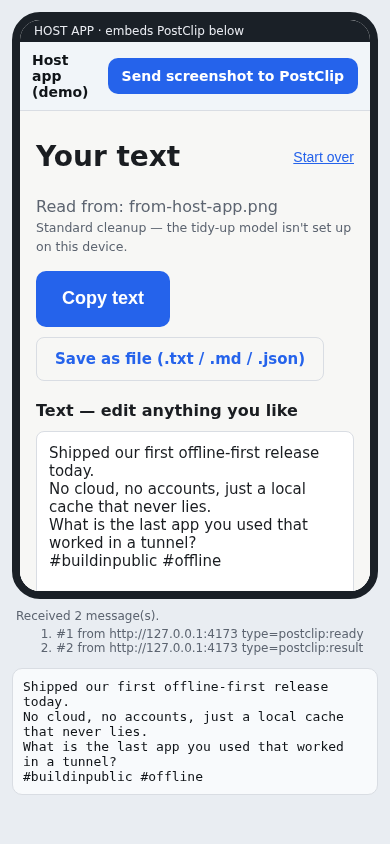
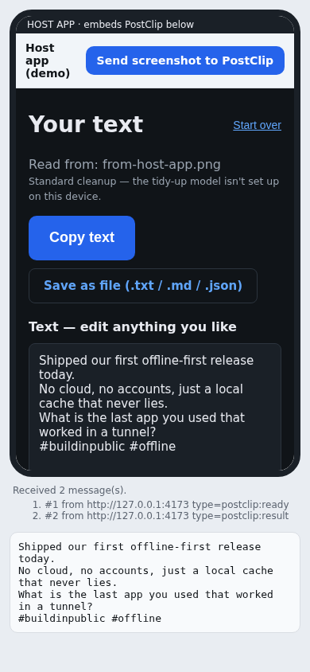
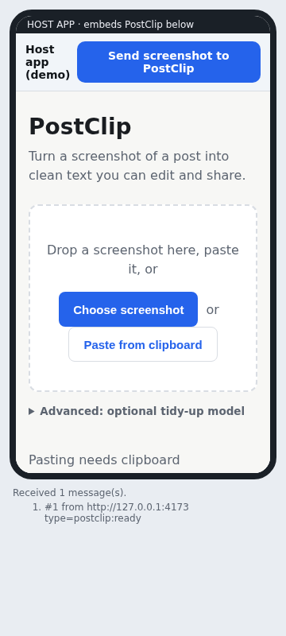
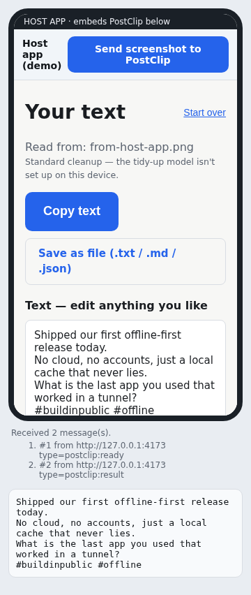
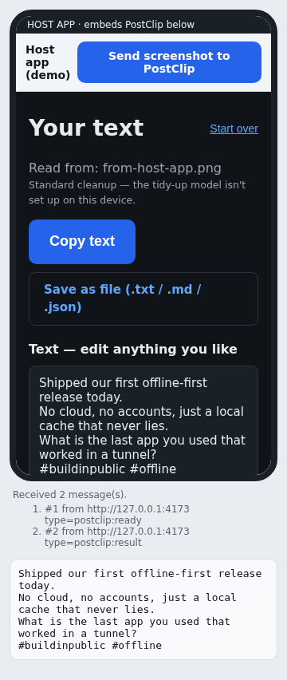

# O08 — PostClip inside a host app (R2-2 owner gallery)

Every screenshot below is from a REAL passing run (the same demo host page the e2e
suite drives: `e2e/fixtures/host/host.html` on a second origin, PostClip embedded in a
cross-origin iframe at `http://127.0.0.1:4173`). The host app hands a screenshot over through the
postMessage contract; the text comes back below the phone. Open this file on a phone.

## The demo host app with PostClip embedded (390x844) — the app fits the frame

## The round trip (390x844) — the host app received the text (below the phone); the app's result screen is inside the frame

## Dark mode (390x844) — the embedded app and the host page both fine

## The demo host app with PostClip embedded (360x800) — the app fits the frame

## The round trip (360x800) — the host app received the text (below the phone); the app's result screen is inside the frame

## Dark mode (360x800) — the embedded app and the host page both fine

---
The owner confirms (plan row O08): PostClip behaves like a component inside a host app —
it fits the frame, the hand-off round trip works, nothing looks broken.
