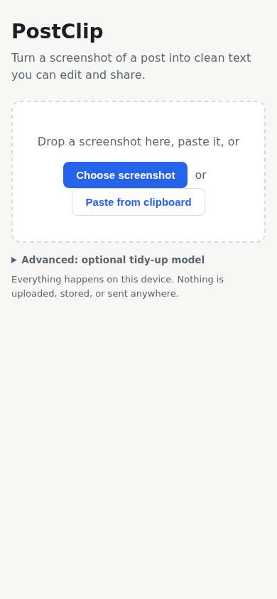
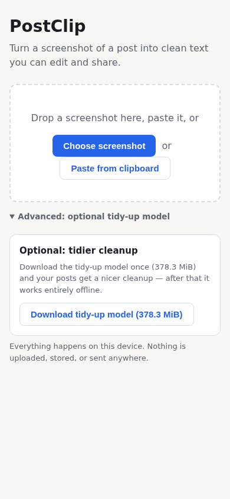
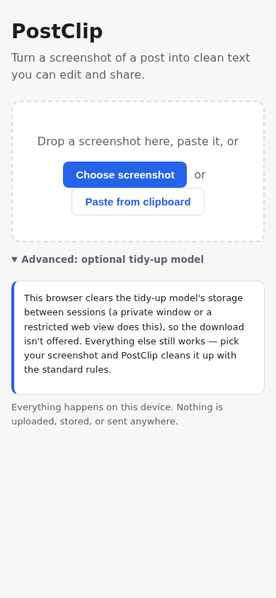
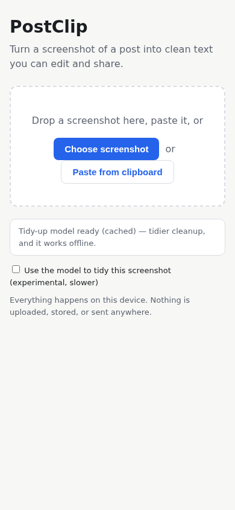
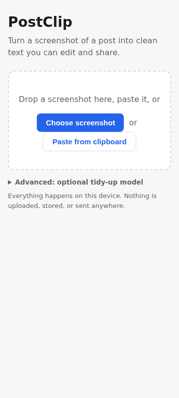
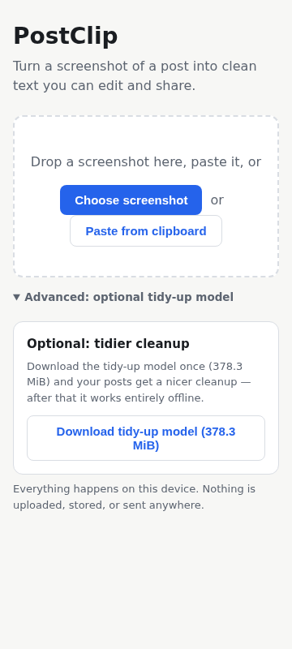
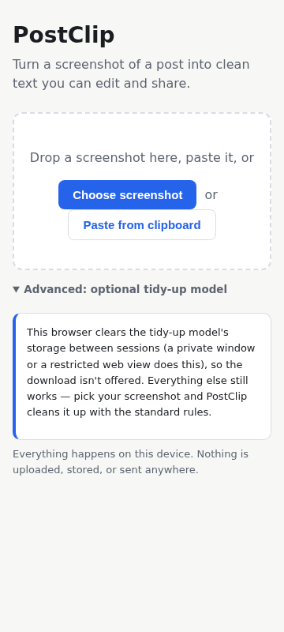
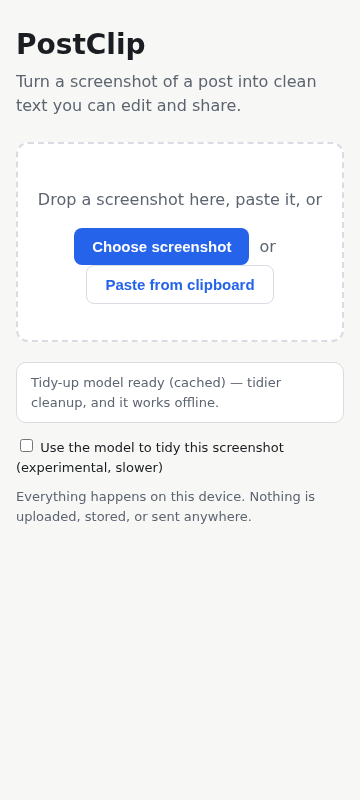

# O09 owner gallery — R2-3: the model downloads once (issue #78)

Real screenshots from a passing run of the test build (Chromium, phone viewports; one real download of the pinned model in a persistent profile; the full e2e matrix is in docs/evidence/R2-3/).

### The home screen (390x844), fresh profile: no model card, no download button — the only trace of the model is the collapsed "Advanced" section

### The Advanced section opened (390x844): the honest one-time-download offer, visible only because you chose to look

### Volatile storage (390x844): the kind explanation replaces the download — no 397 MB that would be lost

### After closing and reopening the browser (390x844): "Tidy-up model ready (cached)" — remembered, no re-download, no download button

### The home screen (360x800), fresh profile: no model card, no download button — the only trace of the model is the collapsed "Advanced" section

### The Advanced section opened (360x800): the honest one-time-download offer, visible only because you chose to look

### Volatile storage (360x800): the kind explanation replaces the download — no 397 MB that would be lost

### After closing and reopening the browser (360x800): "Tidy-up model ready (cached)" — remembered, no re-download, no download button

---

**What you confirm (reply `O09 ok` or `O09 no: <why>`):** the 397 MB download is never pushed at anyone; the model, once downloaded, is remembered across restarts; the ephemeral/lost-cache case is explained kindly.
