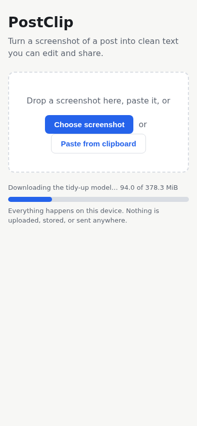
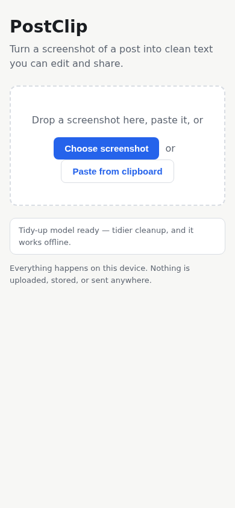
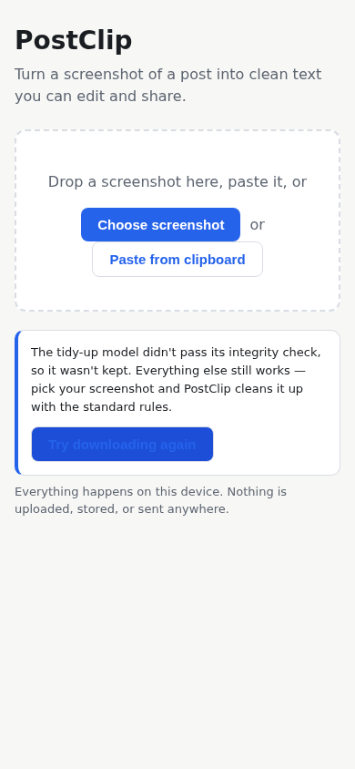
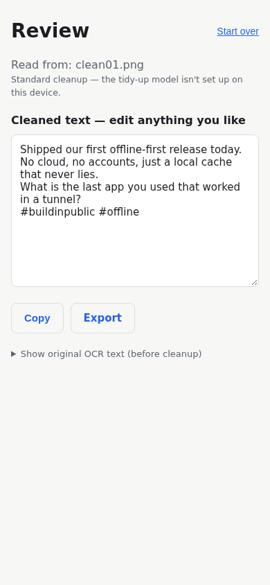
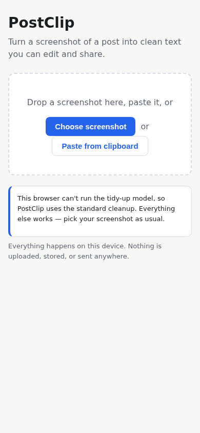

# S3 owner gallery — the tidy-up model (O03)

Real screenshots from a passing run of the built app (Chromium, phone-sized viewport).
The tidy-up model is optional: PostClip works fully without it — these screens show
the download, what happens when it fails, and what you still get.

## 01-model-download-progress.png

Downloading the tidy-up model — live progress bar at 25% (of 377.0 MiB), downloaded once and then offline forever.

## 02-model-ready.png

Download finished and verified — the tidy-up model is ready and works offline.

## 03-model-checksum-failure.png

The download did not pass its integrity check — it was not kept, and the banner says what still works.

## 04-standard-cleanup-still-works.png

Everything still works without the model: the screenshot was read and cleaned up with the standard rules (the review screen says so).

## 05-fallback-banner-unsupported.png

A browser that cannot run the model gets a plain-language banner — PostClip still cleans posts with the standard rules.

What to check (plan row O03): a non-technical person would understand what is
happening and what they still get — a visible download with progress, a clear
message when the file fails its check, and the app still reading and cleaning
posts either way.
