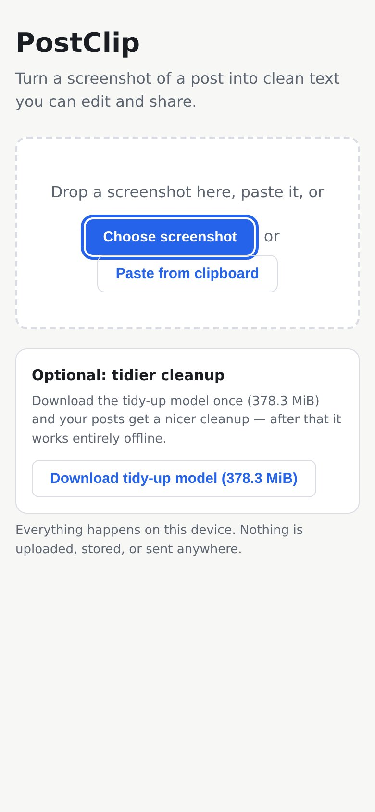
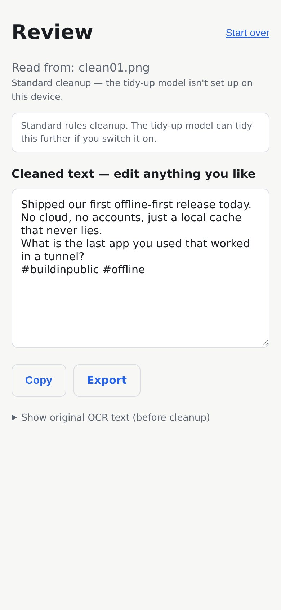
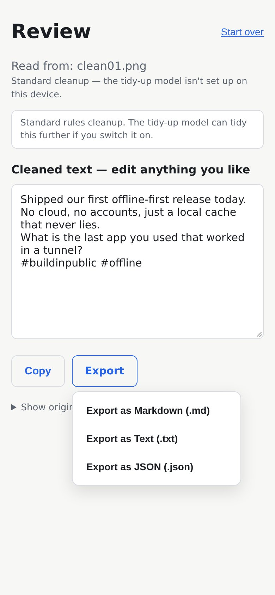
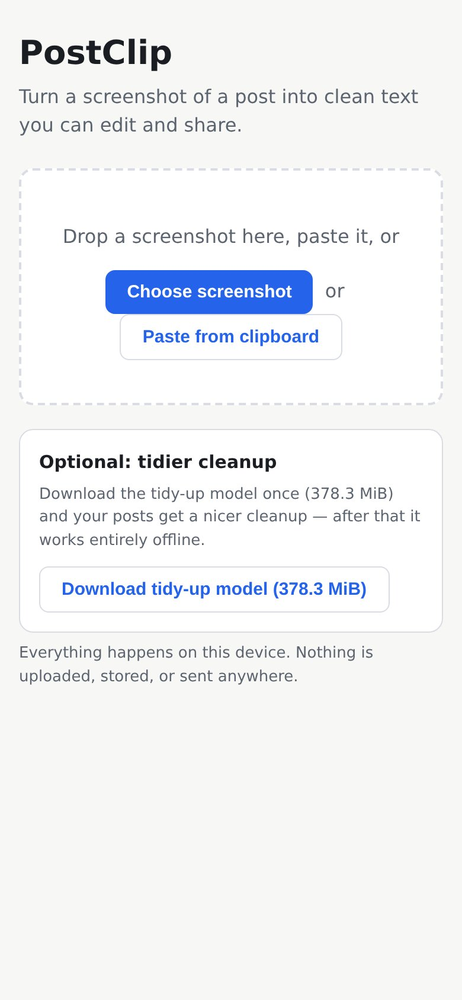
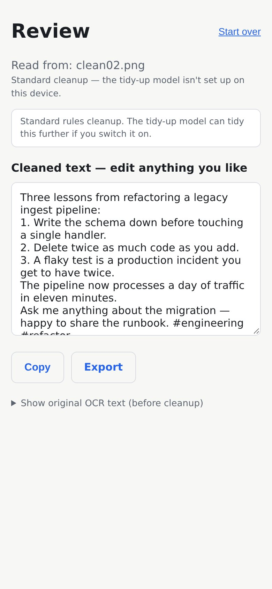

# S5 owner gallery — mobile viewport, offline, keyboard focus (O05)

All screenshots are from one REAL passing run of the app (test build,
Chromium, 390x844 phone viewport, default rules-only state — the model
cleanup is opt-in). What "good" looks like per the plan row O05:
usable one-handed on a phone-sized screen; works offline; focus is visible.

- 
  The home screen at 390x844 — the whole flow (drop, paste, choose) within a one-handed thumb arc.
- 
  Keyboard-only: Tab lands on Choose screenshot with a clearly VISIBLE focus ring (3px outline).
- 
  The review screen at 390x844 after a real pick → OCR → cleanup: readable cleaned text, Share/Copy/Export reachable.
- 
  The export menu (Markdown/Text/JSON) open at 390x844.
- 
  With the network CUT, reloading still brings up the full app — the service worker serves the precached shell.
- 
  Still offline: a second screenshot is read and cleaned entirely on-device (offline OCR — A11's flow), zero network requests.

The engine matrix (Chromium + WebKit), the axe accessibility scans and the
keyboard-only flow are proven by the S5 e2e JUnit in docs/evidence/S5/junit/.
